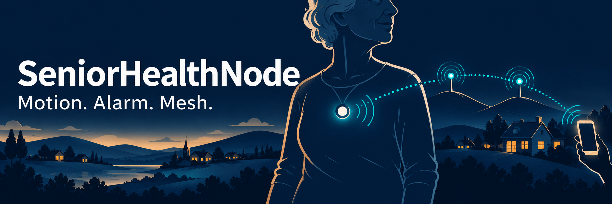
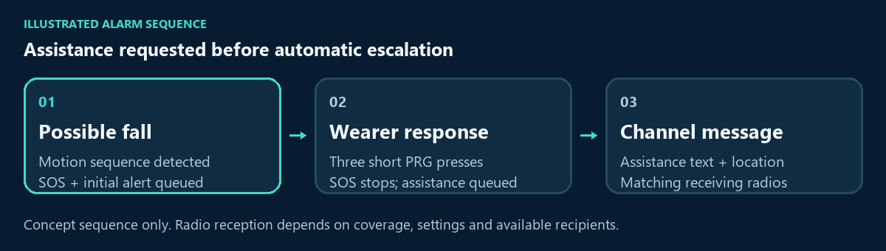

# SeniorHealthNode



*Concept illustration; device appearance and radio connections are schematic.*

[](#prototype-limitations)
[](#meshcore-foundation)
[](#project-highlights)

**Wearable motion monitoring. Local alarms. Mesh alerts beyond cellular coverage.**

SeniorHealthNode is an experimental wearable for older adults, people with limited
mobility, and people who live or work alone. It monitors movement for a possible
fall, sounds a local alarm when a buzzer is fitted, and sends alerts to compatible
MeshCore radios. Family members, caregivers, or other recipients can receive
those messages without cellular service or an internet connection.

**[Get started](docs/setup.md)** · **[Alarm operation](docs/operation.md)** ·
**[Setup FAQ](docs/faq.md#seniorhealthnode)** · **[Documentation](#documentation-guide)**

<a id="prototype-limitations"></a>

> [!IMPORTANT]
> This is a prototype. Fall-detection accuracy and emergency delivery have not
> been validated. Ordinary activity can trigger an alert, and falls can go
> undetected. It is not a validated medical device or guaranteed emergency
> service. An established emergency plan remains necessary.

## Project highlights

| Capability | Experience |
| --- | --- |
| **Local monitoring** | Movement monitoring and alarm handling continue when the phone is disconnected. |
| **Mesh alerts** | Compatible radios receive group-channel messages over the available radio path. Repeaters can extend coverage. |
| **Wearer responses** | After an alarm, PRG button gestures request assistance, confirm a fall, or report a false alarm. |
| **Automatic escalation** | An unanswered alarm sends a warning after 30 seconds; qualifying quiet during the final 10 seconds selects a stronger no-movement warning. |
| **Public or private channels** | The fall-message destination can be changed over USB or a compatible BLE client's local CLI. |
| **Optional sound** | An external passive buzzer provides repeating SOS and low-battery reminders; monitoring and messages also operate without it. |
| **MeshCore companion** | One node provides phone messaging, configuration, and local fall monitoring together. |

## How it connects people

```text
Wearer + firmly attached motion sensor
                  |
                  v
        SeniorHealthNode <---- BLE ----> phone client
          |           |
          |           +---- radio mesh ----> receiving companion ----> recipient
          v
    local SOS alarm
    (optional buzzer)
```

The device is worn firmly on the torso or chest so the sensor moves with the
person. A nearby, unworn node cannot measure the person's body movement. A phone
provides a compatible MeshCore interface for ordinary messaging and setup; it is
not required for local monitoring.

Recipients need compatible listening radios with matching radio settings and the
selected channel key. The default alert channel is public `#falldetect`; private
channels require a shared key configured on every participating node. All fall
notifications are group-channel texts. Radio coverage, power, configuration, and
recipient availability determine whether an alert can reach someone. A recorded
repeater echo does not confirm that a person received or read it.

## What happens after a possible fall

The node sends an initial possible-fall alert and starts repeating SOS when a
buzzer is connected and enabled. PRG becomes the alarm-response button.



*Illustrated assistance path, with presentation timing only; physical delivery is
not demonstrated. [View the static sequence](docs/assets/readme/alarm-walkthrough.svg)
or [read the complete response rules](docs/operation.md).*

| Situation | Wearer action and result |
| --- | --- |
| **Assistance needed** | Three short PRG presses within three seconds stop SOS and send an assistance message with GPS or configured fallback location. After automatic escalation, the same gesture sends fall confirmation. |
| **False alarm** | Complete two PRG presses within one second, then wait until the three-second window from the first press closes. SOS stops and a false-alarm message with location is queued. A valid third press takes priority as assistance/fall confirmation. |
| **No accepted response** | At 30 seconds, an automatic warning is queued. SOS continues, and later assistance or false-alarm responses remain available. |

A third press that starts but is held too long or released late cancels the
pending false-alarm gesture and leaves SOS active. An accepted false-alarm response
cancels that incident's queued automatic warnings and initial-alert retries;
messages already transmitted cannot be recalled. Retries may produce duplicates.
See [alarm operation](docs/operation.md) for complete timings, message examples,
battery reminders, and reboot behavior.

Idle PRG presses do not request help. The current version has no independent
panic button, general inactivity alert, caregiver dashboard or event history,
or automatic call to emergency services.

## Getting started

The current configuration uses a **Heltec V4.3 OLED**, a **GY-521/MPU6050 motion
sensor**, suitable power, and compatible receiving MeshCore equipment. A
**DIYables passive buzzer module** is optional. A USB-connected computer is used
for building, flashing, and diagnostics.

1. Follow the [assembly and setup guide](docs/setup.md) for sensor, optional buzzer,
   power connections, and receiver preparation.
2. Install the single combined firmware using the [build and upload guide](docs/build-validation.md).
3. Pair a phone with a compatible MeshCore client and configure matching radio
   settings and the [fall-message channel](docs/cli_commands.md#fall-message-channel-usb-and-ble).
4. Check sensor readings, response gestures, sound and silence where fitted, and
   actual reception at the intended location using the [setup checks](docs/setup.md)
   and [USB debugging guide](docs/usb_serial_debugging.md).

The default BLE PIN is `12345` (`012345` in a six-digit pairing dialog). A saved
custom PIN takes precedence. Stationary [gyroscope calibration](docs/gyro_calibration.md)
is available as a maintenance procedure; detection pauses during collection.

## Documentation guide

| Task | Guide |
| --- | --- |
| Assemble and configure the device | [Initial setup](docs/setup.md) |
| Understand alarms, button responses and battery reminders | [Operation](docs/operation.md) |
| Resolve setup questions | [SeniorHealthNode FAQ](docs/faq.md#seniorhealthnode) |
| Inspect readings and troubleshoot USB connections | [Windows/Linux serial debugging](docs/usb_serial_debugging.md) |
| Configure channels and local settings | [Command guide](docs/cli_commands.md), [USB configuration and statistics](docs/usb_cli_reference.md) |
| Calibrate the stationary gyroscope | [Calibration procedure](docs/gyro_calibration.md) |
| Check wiring and component specifications | [Pin reference](docs/pin_schematic.md), [sensor and buzzer guide](docs/gy521_sensor.md), [buzzer module](docs/buzzer_module_reference.md), [MPU6050/GY-521](docs/mpu6050_gy521_reference.md), [Heltec V4](docs/heltec_v4_spec_reference.md) |
| Examine detection rules, tuning and research | [Detector and research](docs/fall_detection.md) |
| Understand message retries and delivery evidence | [Response and delivery](docs/message_delivery_changes.md) |
| Inspect source organization and scheduling | [Firmware architecture](docs/architecture.md), [timing](docs/fall_timing_changes.md) |
| Build and evaluate the software | [Build and validation](docs/build-validation.md), [virtual fault testing](docs/virtual-fault-testing.md) |
| Integrate a client | [Companion protocol](docs/companion_protocol.md) |

Software checks exercise program behavior. They do not establish physical sensor
timing, sound output, simultaneous phone/BLE operation, RF coverage, recipient
reception, or detection accuracy on people. The [validation guide](docs/build-validation.md)
defines those evidence boundaries.

## MeshCore foundation

SeniorHealthNode is based on **MeshCore 1.17.0**. Its only firmware target,
`heltec_v4_companion_radio_ble`, combines BLE companion services and local health
monitoring in one image on the same node.

The [upstream MeshCore project](https://github.com/ripplebiz/MeshCore) and
[MeshCore documentation](https://docs.meshcore.io) describe the wider ecosystem.
This repository retains the [MIT license](license.txt). Contribution and
vulnerability-reporting procedures are in [CONTRIBUTING.md](CONTRIBUTING.md) and
[SECURITY.md](SECURITY.md).
